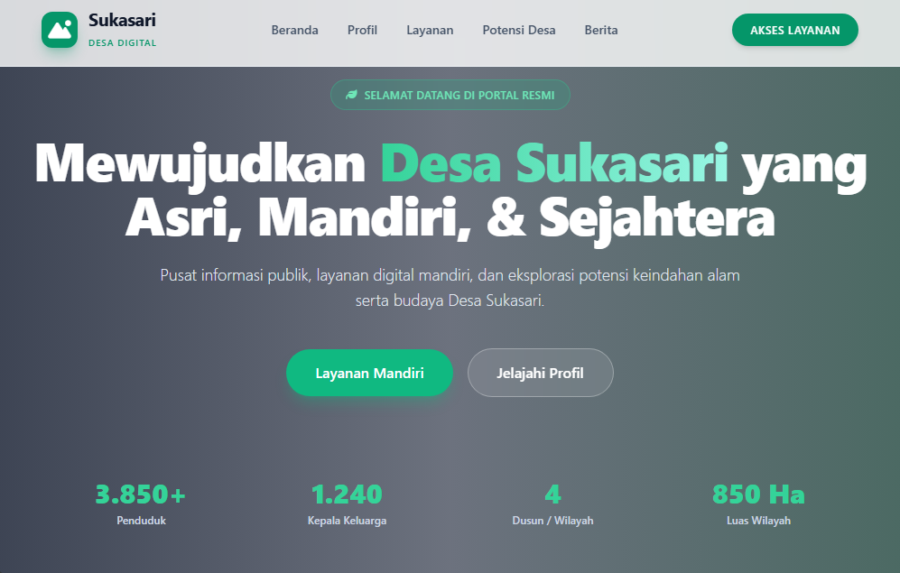

# 🇮🇩 Sistem Layanan Mandiri & Administrasi Kependudukan Desa Sukasari

Repositori ini berisi kode sumber (*source code*) untuk **Web Portal Layanan Mandiri Desa Sukasari**, sebuah aplikasi web berbasis komunitas yang dirancang untuk mempermudah warga desa dalam mengajukan permohonan surat keterangan administrasi secara online, serta menyampaikan aspirasi atau aduan publik.
## 📸 Tampilan Antarmuka (Preview)



---

## 🚀 Fitur Utama

1. **Pengajuan Surat Keterangan Usaha (SKU)**
   - Layanan mandiri bagi pelaku UMKM / pedagang.
   - Pengecekan status (Tracking System) real-time menggunakan Kode Tracking / NIK.
2. **Pengajuan Surat Keterangan Tidak Mampu (SKTM)**
   - Layanan pengajuan dokumen bantuan sosial / pendidikan / kesehatan.
   - Dilengkapi sistem pelacakan status berkas.
3. **Pengajuan Surat Keterangan Domisili**
   - Layanan pencatatan domisili warga dan pendatang.
4. **Layanan Aspirasi & Aduan Warga (Lapor Desa)**
   - Sistem pelaporan masalah infrastruktur, ketertiban, atau layanan publik desa.
   - Mendukung fitur **Laporan Anonim** dan unggah bukti foto.
5. **Sistem Tracking Mandiri (Pop-up Modal)**
   - Warga dapat memantau progres verifikasi berkas (*Menunggu Verifikasi*, *Disetujui/Selesai*, atau *Ditolak*) langsung dari website tanpa perlu login akun.

---

## 🛠️ Teknologi yang Digunakan

- **Frontend:**
  - HTML5 & CSS3
  - [Tailwind CSS](https://tailwindcss.com/) (melalui CDN)
  - [FontAwesome 6](https://fontawesome.com/) (Ikon)
  - JavaScript (Vanilla ES6 + Fetch API / AJAX)
- **Backend:**
  - PHP 8+ (Modular Processing Scripts)
  - PHP Data Objects (PDO) untuk koneksi database yang aman dari *SQL Injection*
- **Database:**
  - MySQL / MariaDB (Dikelola melalui phpMyAdmin)

---

## 📦 Struktur Direktori Proyek

```text
desasukasari-portal/
│
├── index.html                 # Beranda Utama Portal Desa
├── usaha.html                 # Halaman Form & Tracking SKU
├── sktm.html                  # Halaman Form & Tracking SKTM
├── domisili.html              # Halaman Form Domisili
├── aduan.html                 # Halaman Form Pengaduan Warga
│
├── koneksi.php                # File Konfigurasi Koneksi Database PDO
├── process_sku.php            # Backend API Proses & Simpan SKU
├── process_sktm.php           # Backend API Proses & Simpan SKTM
├── check_status_sku.php       # Backend API Tracking Status SKU
├── check_status_sktm.php      # Backend API Tracking Status SKTM
│
├── uploads/                   # Folder penyimpanan file upload (Foto Bukti Aduan)
├── schema.sql                 # Skrip DDL Database MySQL
└── README.md                  # Dokumentasi Proyek


Pengembang : fadli seftian
email : fadliseftian19@gmail.com
